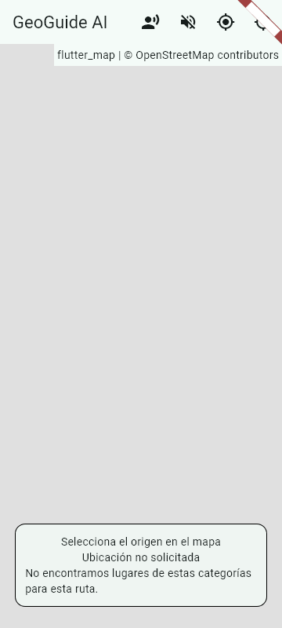
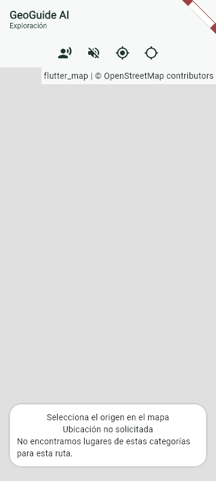

# UI-1 — Evidencia visual comparativa

**Estado:** captura y revisión visual de desarrollo; no evidencia de dispositivo físico, operación GPS, tiles en vivo ni Driving en carretera.

| Propiedad | Valor |
|---|---|
| Antes | Baseline `f4637e64ad08688ab0188528f0a588076501f6b9`, checkout detached de comparación |
| Después | Rama `feature/ui1-design-system-exploration-shell`, cambio sin integrar |
| Renderer | Flutter Widget Test renderer, Flutter 3.47.2 / Dart 3.13.2 |
| Viewport | 360 × 800 logical px, DPR 1.0, portrait, text scale 1.0 |
| Estado | Inicio de exploración; sin ruta, sin modal, ubicación no solicitada y sin sesión GPS |
| Fuentes de la captura | Roboto y Material Icons del SDK Flutter local |
| Limitaciones | El harness bloquea solicitudes HTTP; el área del mapa se muestra sin tiles. La cinta de debug aparece en ambas capturas. El resultado verifica composición Flutter, no un dispositivo real. |

## Comparación equivalente

| Antes — baseline | Después — UI-1 |
|---|---|
|  |  |

La revisión constata tres cambios perceptibles requeridos por UI1-AC-02: la cabecera separa la identidad del rótulo de exploración, los controles existentes ocupan una franja de acciones diferenciada, y el estado usa una superficie blanca con borde y radios centralizados. No se añadieron acciones. El mapa conserva el lienzo principal y la prueba de layout mide más del 50% del área segura visible sin oclusión para el fixture inicial.

El gris uniforme en el lienzo es la ausencia de tiles de red en el renderer de test; no representa un fallo de tiles ni una captura de cartografía real. La comparación demuestra jerarquía, agrupación y tratamiento de superficies con el mismo fixture y dimensiones, no calidad cartográfica ni estado GPS.

Prueba del estado inicial: `mobile/test/features/map/exploration_shell_test.dart`, caso “default exploration keeps at least half its safe area as map”. Las imágenes se generaron con un test de captura local en ambos SHA; el código auxiliar específico de captura y el cargador local de fuentes no forman parte de los tests portables del producto.
